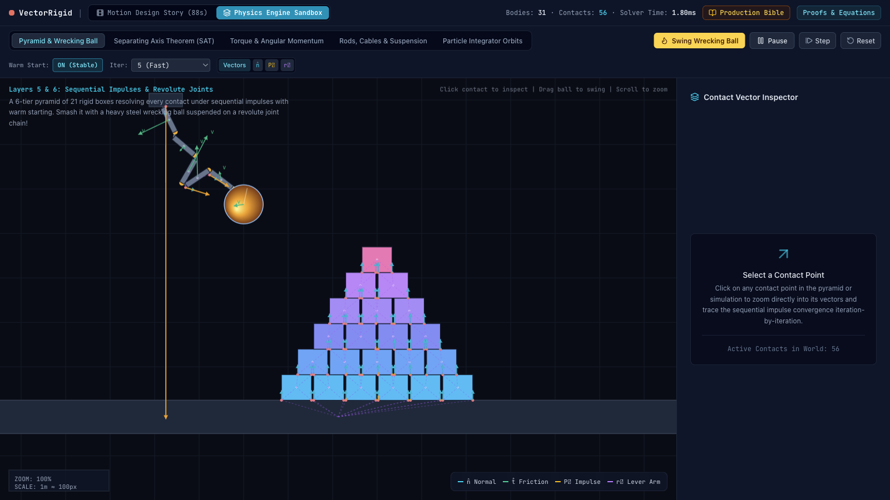
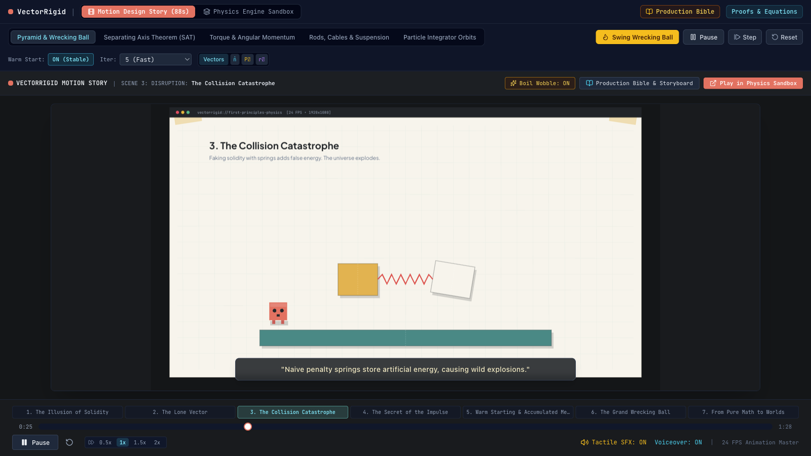

# VectorRigid

A 2D rigid-body physics engine written from scratch in TypeScript, with a browser sandbox that lets you inspect every contact the solver resolves.

**Live demo:** https://neurabytelabs.github.io/vectorrigid/



## What it does

- Simulates boxes, circles, particles, rods, cables and pinned chains with no physics library.
- Shows the contact normal, friction direction, impulse and lever arm for every contact point. Click a contact to zoom in and see how its impulse converges over the solver iterations.
- Lets you switch warm starting on and off and change the iteration count, so you can watch a box stack hold or collapse.
- Ships five scenes: pyramid and wrecking ball, separating axis test, torque and angular momentum, rods and cables, and particle integrator orbits.
- Includes an 88-second narrated explainer ("Motion Design Story") that walks through the same ideas scene by scene. Narration uses the browser's speech synthesis and the sound effects are generated with the Web Audio API, so there are no media files.



## How it works

The engine is split into layers, each in its own folder under `src/physics/`:

1. **Math** (`math/`): `Vec2` and `Mat2`, the only primitives everything else uses.
2. **Particles** (`layer1_particles/`): point masses with explicit Euler, semi-implicit Euler and Verlet integrators, so the orbit scene can compare them.
3. **Constraints** (`layer2_constraints/`): rods (fixed length), cables (maximum length) and springs between particles.
4. **Rigid bodies** (`layer3_rigidbody/`): position, rotation, linear and angular velocity, mass and moment of inertia.
5. **Collision** (`layer4_collision/`): circle-circle, circle-box and box-box tests. Box-box uses the separating axis theorem to find the reference face, then clips the incident edge against it (Sutherland-Hodgman) to get one or two contact points.
6. **Solver** (`layer5_solver/`): sequential impulses (projected Gauss-Seidel). Each contact gets a normal and a friction impulse, clamped so bodies only push, never pull. Impulses from the previous frame are cached by contact key and applied first (warm starting), which is what keeps tall stacks stable with few iterations.
7. **Joints** (`layer6_joints/`): revolute joints solved with a 2x2 effective-mass matrix and a position bias.

`PhysicsWorld.step()` runs two substeps per frame. Each substep integrates velocities, detects collisions, pre-steps contacts and joints (applying warm-start impulses), runs the velocity iterations for joints, contacts and rods together, stores the impulses for the next frame, and then integrates positions.

## Run locally

Requires Node.js 20.19 or newer.

```bash
npm install
npm run dev      # http://localhost:3000
npm run build    # static site in dist/
npm run lint     # type check
```

## Status

Prototype. It runs in current desktop browsers; the layout is not designed for phones. There are no automated tests yet.

## License

MIT. See [LICENSE](LICENSE).
